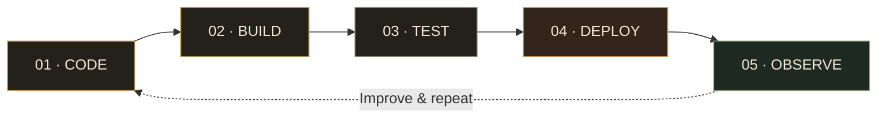

# ARPAN MEHTA

<div align="center">


**Cloud Infrastructure · DevOps · Full-Stack Engineering**

*Build it. Ship it. Observe it. Scale it.*

[Portfolio](https://arpanmehta.dev) · [LinkedIn](https://www.linkedin.com/in/arpan-mehta-ba113228b/) · [Email](mailto:arpanmehta05@gmail.com)

</div>

---

## `$ whoami`

```yaml
name: Arpan Mehta
role: AI Cloud DevOps Engineer
education: Computer Science Engineering
interests:
  - Cloud-native architecture
  - Infrastructure automation
  - CI/CD and platform engineering
  - AI observability
  - Full-stack product development
philosophy: "Automate repeatable work. Engineer for failure."
```

I work across the application and infrastructure layers, building products, automating deployments, and connecting cloud services into systems that are easier to operate and scale.

Currently building **CloudWatcher**, a multi-cloud infrastructure management platform spanning AWS, Azure, and GCP.

---

## `$ pipeline --visualize`

<div align="center">



</div>

<details>
<summary><b>01 / Infrastructure provisioning</b></summary>

Define infrastructure as code, provision cloud resources, configure access policies, and keep environments reproducible.

</details>

<details>
<summary><b>02 / Continuous integration</b></summary>

Build artifacts, validate changes, run tests, and catch failures before deployment.

</details>

<details>
<summary><b>03 / Continuous delivery</b></summary>

Deploy containerized applications through controlled pipelines with environment-specific configuration.

</details>

<details>
<summary><b>04 / Observability</b></summary>

Collect logs, metrics, and traces to understand system behavior and investigate production issues.

</details>

---

## `$ ls ./projects`

<table>
<tr>
<td width="50%" valign="top">

### CloudWatcher

`CLOUD / DEVOPS / AI`

A multi-cloud infrastructure management platform.

- AWS, Azure, and GCP integrations
- Visual infrastructure simulation
- Resource resizing and migration
- AI observability and cloud automation
- Infrastructure visualization

**Focus:** Infrastructure as code, platform engineering, cloud operations.

</td>
<td width="50%" valign="top">

### AiChess

`FULL-STACK / REAL-TIME`

A real-time multiplayer chess platform.

- Stockfish-powered AI
- Live multiplayer matchmaking
- Real-time chat
- Game replay system
- Admin dashboard

**Stack:** MERN, Socket.IO, JWT.

</td>
</tr>
<tr>
<td width="50%" valign="top">

### Euphoria

`FULL-STACK / AI`

An AI-assisted psychological assessment platform.

- MBTI and PERMA assessments
- Gemini API integration
- OAuth authentication
- Administrative analytics

**Stack:** MERN, Gemini API, Azure.

</td>
<td width="50%" valign="top">

### Platform Engineering

`BACKEND / AUTOMATION`

Working across APIs, integrations, deployment environments, access control, and infrastructure workflows.

**Focus:** Reliable services, maintainable architecture, and operational automation.

</td>
</tr>
</table>

[Explore repositories →](https://github.com/arpanmehta05?tab=repositories)

---

## `$ tech --stack`

| Domain | Technologies |
|---|---|
| Cloud | AWS · Azure · GCP |
| Containers | Docker · Kubernetes |
| Infrastructure as Code | Terraform |
| CI/CD | GitHub Actions |
| Backend | Node.js · Express.js · REST APIs |
| Frontend | React · Next.js · Tailwind CSS |
| Databases | MongoDB · PostgreSQL |
| Operations | Linux · Nginx · Git |
| AI Infrastructure | Tracing · Observability · Evaluation |

---

## `$ roadmap --next`

Ideas I'm interested in exploring and building:

<details>
<summary><b>01 · Self-healing infrastructure</b></summary>

Detect unhealthy services, correlate monitoring signals, and trigger safe automated remediation with rollback controls.

</details>

<details>
<summary><b>02 · Multi-cloud cost intelligence</b></summary>

Analyze resource utilization across AWS, Azure, and GCP, identify idle infrastructure, and recommend cost optimizations.

</details>

<details>
<summary><b>03 · AI-powered incident investigator</b></summary>

Correlate logs, metrics, traces, and deployment events to identify probable root causes and generate incident summaries.

</details>

<details>
<summary><b>04 · Ephemeral preview environments</b></summary>

Automatically provision isolated environments for pull requests, run validation tests, and destroy the environments after merging.

</details>

<details>
<summary><b>05 · Developer control plane</b></summary>

Build a unified interface for deployments, infrastructure health, secrets management, and service ownership across environments.

</details>

---

## `$ git log --career`

```text
2026  AI Cloud DevOps Engineer
      Multi-cloud platforms · Automation · AI observability

2025  Open Source Chandigarh DSA Team
      Open-source collaboration · Problem solving

2024  Full-Stack Development
      Application development · Backend engineering

2023  Computer Science Engineering
      Foundations · Software development
```

---

<div align="center">

### BUILD SOMETHING. AUTOMATE IT. MAKE IT BETTER.

</div>
